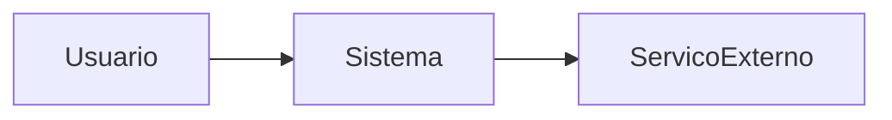

# <Nome do sistema>

> Última verificação contra o código: <data> · commit <hash>

## Propósito
<O que o sistema faz, para quem, e qual problema resolve.>

## Atores
| Ator | O que faz no sistema |
|---|---|

## Contexto

## Stack e comandos
| Item | Valor | Evidência |
|---|---|---|
| Linguagem / framework | | |
| Build | | |
| Testes | | |
| Executar local | | |

## Mapa de módulos
| Módulo | Responsabilidade | Doc |
|---|---|---|

## Glossário
| Termo | Significado |
|---|---|

## Lacunas conhecidas
Ver [open-questions.md](open-questions.md).
